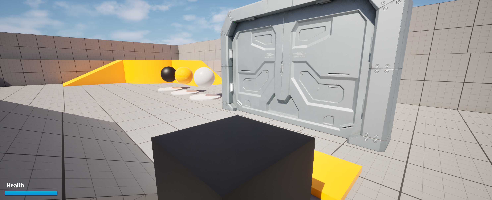
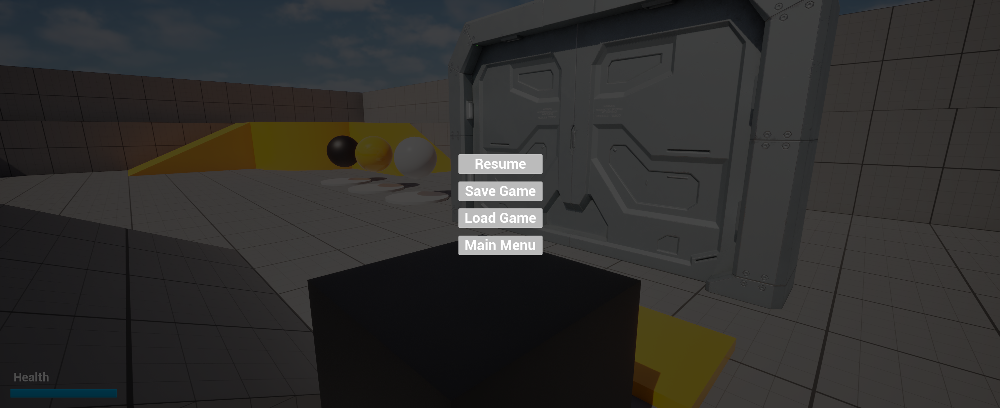
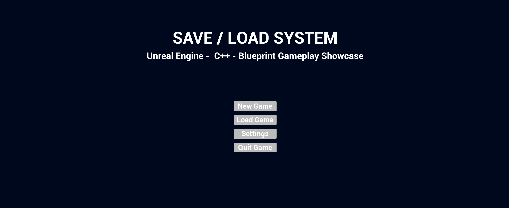
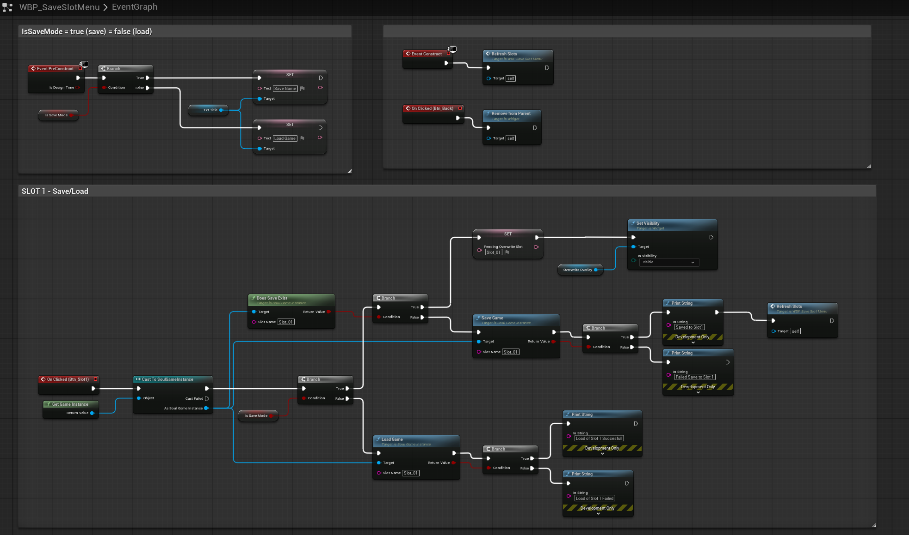
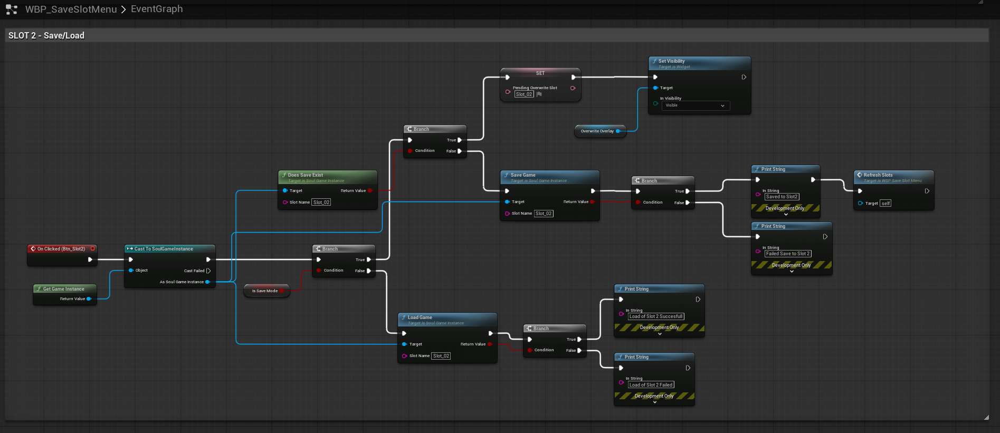
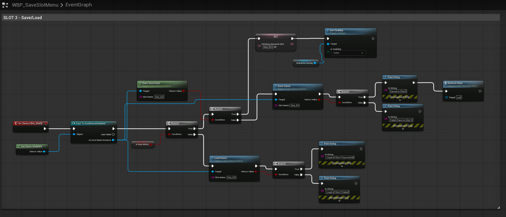
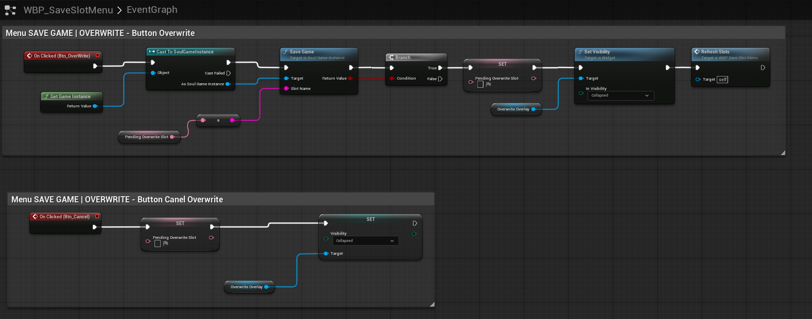
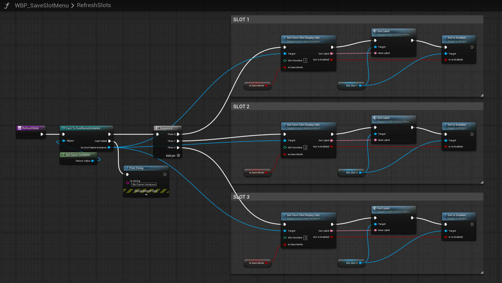

# Save / Load System — Unreal Engine C++

A save/load system developed for **A Soul in Three** as Assignment 11 of an Unreal Engine C++ course. It restores the current level, player state, collected artifacts, and the position of a physics-based puzzle weight. C++ handles persistence and gameplay behavior, while Blueprints connect the system to the menus and player input.

This repository presents selected source files, Blueprint screenshots, and a gameplay demonstration.

## Demo Video

[▶ Watch the demo on YouTube](https://youtu.be/lk9QiububXw)

## Gameplay and UI Preview

### Puzzle Test Level

The test scene brings together the movable weight, sliding door, collectible artifacts, and health HUD.

### Pause Menu

Saving and loading are available while the game is paused.

### Main Menu

The showcase starts from the Main Menu, which provides access to New Game and Load Game.

### Overwrite Confirmation

An occupied slot opens a confirmation overlay with Overwrite and Cancel actions.

## Update — 10 November 2026

Added an instant door-state restoration path. When loading a save, the intended behavior is for each puzzle door to appear already open or closed according to the restored weight position, rather than replaying its opening animation from zero. Normal weight placement and removal still use animated movement during gameplay.

| Changed file | Change |
|---|---|
| [`SlidingDoor.h`](SlidingDoor.h) | Declares `SetDoorOpenInstant(bool bOpen)` and the `PostInitializeComponents()` override |
| [`SlidingDoor.cpp`](SlidingDoor.cpp) | Implements instant restoration by clearing the closing timer, setting `bShouldOpen` and `OpenAmount`, and positioning both panels directly without calling the opening/closing sound functions |
| [`SlidingDoor.cpp`](SlidingDoor.cpp) | Captures closed panel positions in `PostInitializeComponents()` instead of `BeginPlay()`, preparing them before save restoration and preventing later initialization from recording an open position as closed |
| [`PressurePlate.cpp`](PressurePlate.cpp) | Updates overlaps after restoring the weight and calls `SetDoorOpenInstant()` using the plate's detected occupancy |

The save format is unchanged: the weight transform remains the source of truth for the door state. This update adds the restoration path; the previously observed load-time animation still needs a final runtime check, including overlap availability during level initialization. The linked video was recorded before this update.

## Assignment Requirements

| Requirement | Implementation |
|---|---|
| Save and load from the Pause Menu | A shared slot-selection widget opened in Save or Load mode |
| Load from the Main Menu | The same widget opened in Load mode |
| Restore the current level | The saved level name is passed to `OpenLevel()` |
| Restore player position and state | Player transform, control rotation, health, and collected artifact IDs |
| Restore interactive object state | The puzzle weight's transform is restored, and the pressure plate recalculates the door state |
| Additional task: selectable save slots | Three slots: `Slot_01`, `Slot_02`, and `Slot_03` |

## Features

- Three independent save slots with empty-slot handling and save timestamps.
- Confirmation before overwriting an occupied slot, with a Cancel option.
- Empty slots disabled in Load mode and available in Save mode.
- Save timestamps stored in UTC and formatted for display with `FText::AsDateTime()`.
- Player location, rotation, viewing direction, health, and collected artifacts persisted between sessions.
- Physics object grabbing and releasing through a Physics Handle.
- A pressure plate that opens its linked door only while its assigned weight overlaps the trigger.
- Weight position, rotation, and scale saved under a unique pressure plate ID.
- An event-driven health bar that updates when health or the possessed pawn changes.

## C++ Implementation

### Save Data

[`USoulSaveGame`](SoulSaveGame.h) stores the level name, player transform, health, collected artifact IDs, control rotation, and save timestamp. `bHasPlayerControlRotation` indicates whether a saved viewing direction is available.

Interactive puzzle data is stored in a `TMap<FName, FPressurePlateSaveData>`. Each key is the pressure plate's editor-assigned `SaveId`; its value contains the assigned weight's `FTransform`. IDs must be nonempty and unique within the saved level.

### Saving and Loading

[`USoulGameInstance`](SoulGameInstance.cpp) coordinates persistence. `SaveGame()` captures the player state, visits pressure plate actors to collect their weight transforms, and writes the result with `UGameplayStatics::SaveGameToSlot()`.

`LoadGame()` reads the selected slot, retains the data in `PendingSaveData`, restores the collected artifact set, and opens the saved level. After the new player pawn is ready, the project calls `ApplyPendingSave()` to restore the player and puzzle transforms. The pending reference is then cleared.

The source also exposes `DoesSaveExist()`, `GetSaveSlotDate()`, and `GetSaveSlotDisplayInfo()` for menu integration. The display helper returns the slot label and whether its button should be enabled. `StartNewGame()` clears collected artifacts and pending data before opening the test level.

### Pressure Plate and Door

[`APressurePlate`](PressurePlate.cpp) detects overlaps with the Physics Body channel and responds only to its assigned `RequiredWeight`. It calls `SetDoorOpen()` on its `LinkedDoor` using the result of `IsOverlappingActor()`.

The door's open/closed state is **derived from the restored weight position**, rather than stored as an independent boolean. This keeps the door consistent with the puzzle: weight on the plate means open; weight off the plate means closed. Player proximity must not override this behavior, so **Open on Player Overlap is disabled** for puzzle doors.

During restoration, the weight is teleported using `TeleportPhysics`. Its linear and angular velocities are cleared, overlaps are updated, and the plate refreshes the door state. Velocity and the player's current grab state are not included in the save data.

[`ASlidingDoor`](SlidingDoor.cpp) animates two panels between their closed and open positions using a normalized opening amount and `DeltaTime`. The class also retains an optional player-proximity mode for other uses.

### Object Grabbing

[`UGrabberComponent`](GrabberComponent.cpp) performs a sphere sweep along the owner's eye direction on the Visibility channel, ignoring its owner. A hit component must simulate physics before it can be grabbed.

A Physics Handle holds the object at the impact point and retains its initial rotation. Each tick, the handle's target location moves to a configurable distance in front of the player. `ToggleGrab()` switches between grabbing and releasing; the demonstration binds this to **E**.

### Health and HUD

[`HealthComponent.cpp`](HealthComponent.cpp) provides the health state used by the save system. [`UPlayerHUDWidget`](PlayerHUDWidget.cpp) observes health-change and pawn-possession events, updates the progress bar, and removes its delegate bindings when the widget is destroyed.

## Blueprint Integration

The screenshots below show the current menu integration: opening the shared slot widget, routing each slot to save or load, and confirming or cancelling an overwrite.

### Pause Menu

The Pause Menu provides Resume, Main Menu, Save, and Load actions. Save and Load create the same slot widget with different values of `Is Save Mode`.

### Main Menu

New Game calls the Game Instance reset function. Load opens the slot widget in Load mode and switches input to the UI.

### Slot Menu and Slot Actions

The widget changes its title according to its mode and refreshes the slot buttons when constructed. Each button routes to saving or loading its corresponding slot. Occupied save slots use the shared overwrite confirmation.

### Overwrite Confirmation

The Overwrite action saves to `PendingOverwriteSlot`, closes the confirmation overlay, and refreshes the slots after success. Cancel clears the pending selection and closes the overlay.

### Slot Availability

The C++ function `GetSaveSlotDisplayInfo()` supplies each slot label and its availability. A slot is enabled when a save exists or the widget is in Save mode; empty slots are disabled in Load mode. The menu applies the returned values to its button labels and enabled states.

`RefreshSlots` gets the Game Instance and uses a Sequence to update slots 1, 2, and 3. Each call passes the slot number and `Is Save Mode` to the C++ helper, then connects `Out Label` to `Set Label` and `Out Is Enabled` to `Set Is Enabled` on the corresponding button.

## Demonstration Controls and Test Flow

Use **E** to grab or release a physics object and **P** to open the Pause Menu. The project's health test inputs use **H** for damage and **J** for healing; these input bindings are configured outside the supplied source files.

To demonstrate persistence, change the player's health, collect an artifact, place the weight on the plate, and save to a selected slot. Move away and remove the weight so that the door closes. Loading the slot restores the saved player state and weight placement, causing the door to reopen. Loading is available from both the Pause Menu and Main Menu. Saving a different state to another slot demonstrates independent saves.

## Repository Contents

| Files | Responsibility |
|---|---|
| [`SoulSaveGame.h`](SoulSaveGame.h), [`SoulSaveGame.cpp`](SoulSaveGame.cpp) | Save object and puzzle data structure |
| [`SoulGameInstance.h`](SoulGameInstance.h), [`SoulGameInstance.cpp`](SoulGameInstance.cpp) | Save/load orchestration, artifact tracking, and slot display helpers |
| [`PressurePlate.h`](PressurePlate.h), [`PressurePlate.cpp`](PressurePlate.cpp) | Weight detection, door control, and puzzle data capture/restoration |
| [`SlidingDoor.h`](SlidingDoor.h), [`SlidingDoor.cpp`](SlidingDoor.cpp) | Door components, movement, sound, and control modes |
| [`GrabberComponent.h`](GrabberComponent.h), [`GrabberComponent.cpp`](GrabberComponent.cpp) | Sphere sweep, Physics Handle grabbing, and release |
| [`HealthComponent.h`](HealthComponent.h), [`HealthComponent.cpp`](HealthComponent.cpp) | Health state, damage/healing, and change notifications |
| [`PlayerHUDWidget.h`](PlayerHUDWidget.h), [`PlayerHUDWidget.cpp`](PlayerHUDWidget.cpp) | Health bar observation and updates |
| [`screenshots/`](screenshots/) | Blueprint documentation |

## Integration Notes

This is a **source-code and visual showcase**, not a complete runnable Unreal Engine project. The repository does not include a `.uproject`, module build files, maps, Blueprint assets, or the project's complete gameplay source.

In a host project, replace `ASOULINTHREE_API` with the appropriate module export macro, configure the Game Instance, and call `ApplyPendingSave()` after the player and relevant level actors are ready. Recreate the menu and input integration, assign meshes and sounds, and provide the project's artifact pickup behavior.

Add Grabber and Physics Handle components to the player. Use a physics-simulating mesh as the weight actor's root so that its actor transform follows the moving body. Configure the weight and walls to block Visibility for grabbing, enable the necessary physics overlaps, and assign each plate its own `SaveId`, `RequiredWeight`, and `LinkedDoor`. Disable player-proximity opening on doors controlled by plates.

## Future Improvements

- Extract repeated slot button updates into a reusable `RefreshSlot(SlotNumber, SlotButton)` Blueprint function while keeping label and availability decisions in C++.
- If the menu grows, introduce a native `USaveSlotMenuWidget` that refreshes buttons in a loop while preserving Designer-editable layouts.
- Generalize interactive object persistence beyond pressure plates through a shared save interface and stable object IDs.
- Add save-format versioning and clearer player-facing feedback when saving or restoring an object fails.

## Asset Credits

The demonstration reuses door assets from the earlier sliding-door project: [Sci-Fi Doors](https://www.fab.com/listings/e9058da5-7b15-426f-b206-8db9bc69c5eb) by **lavrenov** on Fab, and [Sci-fi automatic door](https://freesound.org/people/saangosu/packs/42520/) audio by **saangosu** on Freesound (CC0). External assets are not included here.

